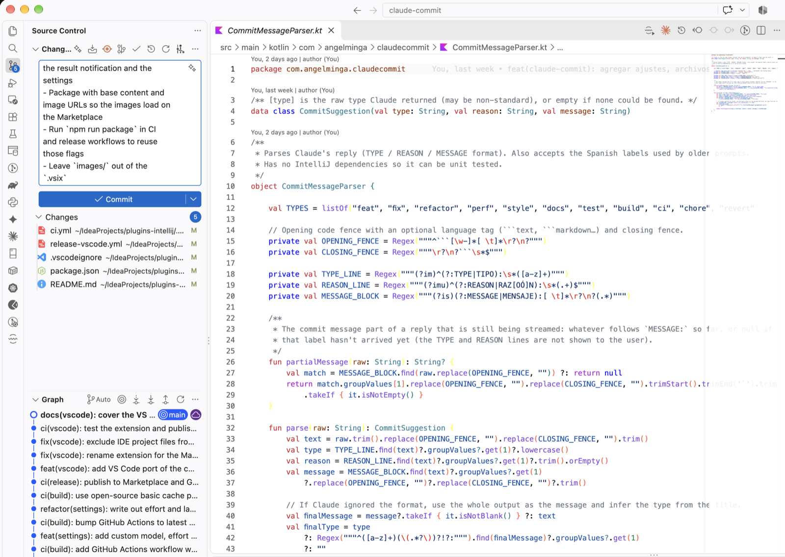
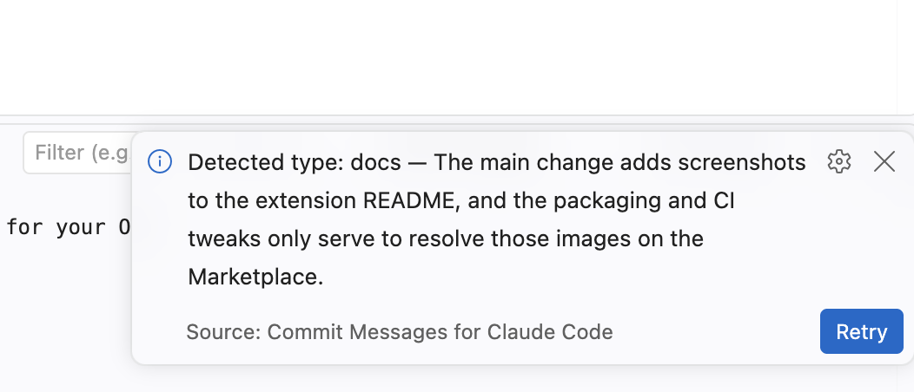
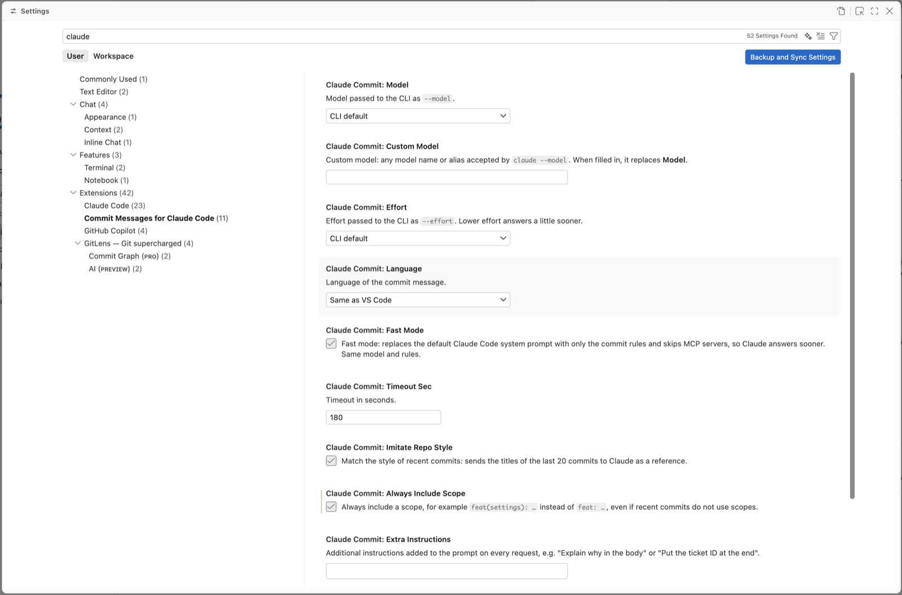

# Commit Messages for Claude Code (VS Code)

Adds a button to the Source Control view that sends your changes to the [Claude Code](https://claude.com/claude-code) CLI
(`claude -p`, uses your Claude subscription, no API key) and fills in a [Conventional Commits](https://www.conventionalcommits.org)
message. VS Code port of the JetBrains plugin of the same name.

## Requirements

- Claude Code installed and logged in: run `claude` once in a terminal.
- The built-in Git extension enabled.

## Usage

Click the Claude icon in the Source Control title bar (or run **Generate Commit Message with Claude** from the Command
Palette). The message streams into the commit box; a notification shows the detected type and offers **Retry** for a
different wording. While it runs, the icon turns into a spinner that stops the request.

What is sent: the staged changes, or every change (including untracked files) when nothing is staged, the same set
VS Code commits. Generated folders, lock files and minified bundles are listed by name only. The current branch and,
optionally, the titles of the last 20 commits are sent too, so Claude can match the repository's style.

## Screenshots

**Generate** — the Claude button in the Source Control view; the message streams into the commit box:



**Result** — the detected type and the reason, with **Retry** for a different wording:



**Settings** — model, language, fast mode, scope and more:



## Settings

Under **Settings → Extensions → Commit Messages for Claude Code**: model and effort, message language (defaults to
VS Code's), fast mode, timeout, match recent commit style, always include a scope, additional instructions, replace
without asking and the path to the `claude` executable.

## Privacy

The extension sends nothing by itself and has no telemetry: the local `claude` CLI sends the data above to Anthropic
under your own account. See the [privacy policy](https://github.com/AngelMinga/claude-commit/blob/main/PRIVACY.md).

## Development

```bash
npm install
npm test            # compiles and runs the unit tests (node:test)
npm run package     # → commit-messages-for-claude-code-<version>.vsix
```

Press F5 in VS Code to open an Extension Development Host with the extension loaded. Install the `.vsix` with
**Extensions → ⋯ → Install from VSIX…**.

`src/client.ts`, `src/parser.ts`, `src/streamJson.ts` and `src/diff.ts` have no VS Code dependencies and mirror the
Kotlin plugin; the normal-mode prompt test uses the same expected text as `ClaudeClientLegacyGoldenTest`, so keep both in
sync when the prompt changes.
